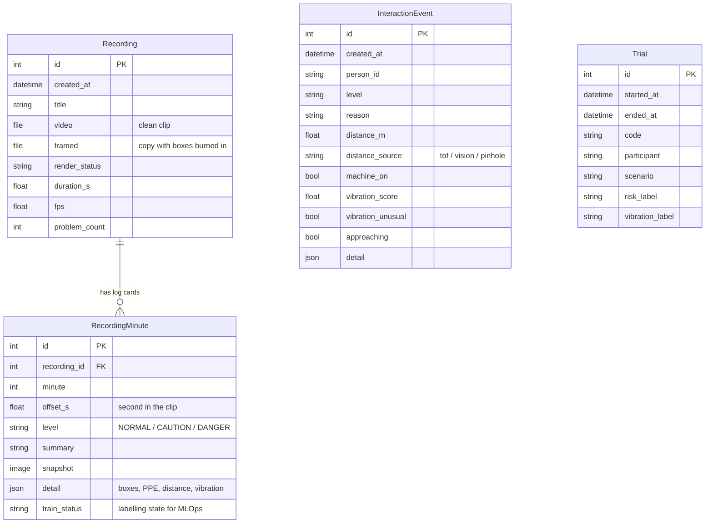
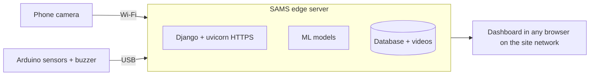

# SAMS — Smart Accident Monitoring System

SAMS warns workers **before** they get hurt near industrial machines. A phone camera and an accelerometer watch the machine area. Machine-learning models detect the worker, estimate how far they are from the machine, check their protective gear, and read the machine's vibration. A fusion model then turns all of that into one risk level, **NORMAL**, **CAUTION** or **DANGER**, and drives a buzzer and warning LEDs in real time. Every analysed clip is archived so a safety officer can review incidents and label data for retraining.

- **Repository:** <https://github.com/Bonaparte003/Smart-Accident-System-Monitoring-SAMS->
- **Video demo:** _add link here_
- **Track:** ML Track (models, notebooks, metrics) with a full-stack web MVP and hardware integration
- **ML report:** [`notebooks/README.md`](notebooks/README.md) covers data visualisation, EDA, model architectures, experiments and metrics for all eight models

---

## Table of contents

1. [Features](#features)
2. [System architecture](#system-architecture)
3. [Tech stack](#tech-stack)
4. [Project structure](#project-structure)
5. [Setting up the environment](#setting-up-the-environment)
6. [Running the app](#running-the-app)
7. [Using the app](#using-the-app)
8. [Hardware](#hardware)
9. [API](#api)
10. [Database schema](#database-schema)
11. [Machine-learning models](#machine-learning-models)
12. [Designs and screenshots](#designs-and-screenshots)
13. [Testing](#testing)
14. [Deployment plan](#deployment-plan)
15. [Known limitations and next steps](#known-limitations-and-next-steps)

---

## Features

| Feature | What it does |
|---|---|
| **Control Center** | Combines person detection, distance, PPE and vibration into one live NORMAL / CAUTION / DANGER decision with class probabilities |
| **Live phone camera** | An Android phone joins by scanning a QR code and streams frames over Wi-Fi (HTTPS) |
| **Video upload** | Drop an MP4 / MOV / WebM clip and SAMS analyses sampled frames |
| **Person and distance** | YOLOv8 finds each worker; a pose-based neural network (plus an optional time-of-flight sensor) estimates distance to the machine |
| **PPE check** | Detects hard hat, safety vest, gloves and safety shoes on each worker |
| **Fire / smoke and falls** | YOLOv8 detectors for fire and smoke hazards and for a person lying on the floor |
| **Vibration monitoring** | An MPU6050 accelerometer streams 50 Hz windows into a NORMAL / ABNORMAL classifier |
| **Alerts on hardware** | Buzzer patterns and green / yellow / red LEDs follow the risk level automatically |
| **Review dashboard** | Signed-in home overview with trends, device health and storage |
| **Archive** | Every analysed clip is saved with a timestamped log card per sampled second and a "framed" copy with boxes burned in |
| **Alerts page** | All CAUTION and DANGER moments in one list, linked to the exact second in the recording |
| **MLOps desk** | Model inventory, labelling of archived moments, and a ZIP export (clean frames plus `labels.csv`) for retraining |

---

## System architecture

```mermaid
flowchart LR
    subgraph Edge devices
        PHONE[Android phone camera]
        ARD[Arduino: MPU6050, VL53L0X ToF, buzzer, LEDs]
    end
    subgraph SAMS server - Django on uvicorn, HTTPS
        VIS[vision_inference: YOLOv8 person + pose]
        PPE[ppe_inference]
        HAZ[hazard_inference]
        ACC[accident_inference]
        DIST[distance_estimation]
        VIB[vibration_inference]
        CC[control_center + fusion_inference]
        REC[recordings + video_jobs]
        DB[(SQLite)]
    end
    UI[Web UI: Control Center and review dashboard]

    PHONE -- frames over Wi-Fi --> VIS
    ARD -- serial 115200 baud --> VIB
    ARD -- ToF distance --> DIST
    VIS --> PPE
    VIS --> DIST
    VIS --> HAZ
    VIS --> ACC
    DIST --> CC
    VIB --> CC
    PPE --> CC
    CC -- buzzer / LED commands --> ARD
    CC --> UI
    REC --> DB
    DB --> UI
```

**How a decision is made** (`monitoring/services/control_center.py`):

1. The vision pipeline detects the worker and estimates distance, from the ToF sensor at close range or the distance network further away.
2. The worker's speed and whether they are approaching are computed from successive distance readings.
3. The vibration window from the MPU6050 gives an anomaly score and a NORMAL / ABNORMAL state.
4. These become the fusion feature vector: caution zone ≤ 2.0 m, danger zone ≤ 0.8 m, plus speed, approach, machine on/off and vibration.
5. The fusion model returns NORMAL, CAUTION or DANGER with probabilities. If a person is seen but no distance can be measured, SAMS reports **DEGRADED** instead of guessing.
6. When the label changes, the buzzer and LEDs are updated, and the interaction is written to the database.

---

## Tech stack

| Layer | Tools |
|---|---|
| Backend | Python 3.12, Django 6.1, uvicorn (ASGI, HTTPS), django-cors-headers |
| Database | SQLite (Django ORM, migrations in `monitoring/migrations/`) |
| Frontend | Django templates, vanilla JavaScript, CSS, Font Awesome, Inter font |
| ML / CV | PyTorch 2.2, torchvision, Ultralytics YOLOv8, scikit-learn 1.5, XGBoost, OpenCV, NumPy, SciPy |
| Video | imageio + imageio-ffmpeg |
| Hardware | Arduino Uno / Nano, MPU6050, VL53L0X, buzzer, LEDs, pyserial, arduino-cli |
| Notebooks | Jupyter (training, EDA and evaluation for every model) |

---

## Project structure

```text
SAMS/
├── SAMS/                    # Django project: settings, urls, asgi/wsgi
├── monitoring/              # Main Django app
│   ├── models.py            # Recording, RecordingMinute, InteractionEvent, Trial
│   ├── views.py             # Control Center page + JSON API
│   ├── review_views.py      # Signed-in dashboard: home, archive, alerts, MLOps
│   ├── services/            # Inference, fusion, recordings, MLOps logic
│   ├── templates/monitoring/
│   ├── static/monitoring/   # css/, js/ (app.js, control.js, vision.js, vibration.js)
│   └── tests.py
├── hardware/                # Serial stream, buzzer, LEDs, ToF, phone camera, certs
│   ├── firmware/            # Arduino sketches (mpu6050_serial, buzzer_d8_debug)
│   └── tools/hw.sh          # Flash, test and run helper
├── notebooks/               # 8 training notebooks + README (ML report)
├── results/                 # EDA figures, experiment ledgers, metric CSVs
├── models/                  # Trained weights (not in git, see setup step 4)
├── scripts/                 # Stand-alone training scripts
├── requirements.txt
└── manage.py                # `runserver` is overridden to start uvicorn over HTTPS
```

---

## Setting up the environment

### Prerequisites

- **Python 3.12.** Python 3.13 and 3.14 will **not** work, because `torch==2.2.2` and `numpy==1.26.4` have no wheels for them. On macOS: `brew install python@3.12`.
- **Git.**
- **OpenSSL**, used to create the self-signed HTTPS certificate (preinstalled on macOS and most Linux distributions).
- Optional, for the live hardware demo: an Arduino Uno or Nano with the sensors listed under [Hardware](#hardware), [`arduino-cli`](https://arduino.github.io/arduino-cli/), and an Android phone on the same Wi-Fi network.

### Steps

```bash
# 1. Clone
git clone https://github.com/Bonaparte003/Smart-Accident-System-Monitoring-SAMS-.git
cd Smart-Accident-System-Monitoring-SAMS-

# 2. Create and activate a virtual environment (Python 3.12)
python3.12 -m venv myenv
source myenv/bin/activate          # Windows: myenv\Scripts\activate

# 3. Install dependencies
pip install --upgrade pip
pip install -r requirements.txt

# 4. Download the trained models (about 1.2 GB, kept out of git)
#    Link: add link here
#    Unzip so that the folder layout is ./models/fusion, ./models/vibration, ./models/vision

# 5. Create the database and an account for the review dashboard
python manage.py migrate
python manage.py createsuperuser
```

After step 4 the app expects these files (the paths are read by the services in `monitoring/services/`):

| Model | Path |
|---|---|
| Fusion | `models/fusion/best_fusion_model/model.joblib` + `metadata.json` |
| Vibration | `models/vibration/` (`best/` and the per-experiment folders) |
| PPE | `models/vision/ppe/best.pt` + `metadata.json` |
| Fire / smoke | `models/vision/hazard/best.pt` |
| Fall | `models/vision/accident/best.pt` |
| Distance | `models/vision/distance/distance_nn.pt` + `calib.json` |
| Pose | `models/vision/pose/best.pt`, or the stock `models/vision/yolov8n-pose.pt` |

If you would rather retrain than download, run the notebooks in `notebooks/`. Each one writes its promoted model into `models/`.

### Optional environment variables

All have sensible defaults, so none are required for a first run.

| Variable | Default | Purpose |
|---|---|---|
| `SAMS_HW_SERIAL_PORT` | empty (no board) | Arduino serial port, e.g. `/dev/cu.usbserial-1410` |
| `SAMS_HW_SERIAL_BAUD` | `115200` | Serial speed |
| `SAMS_HW_SAMPLE_RATE` | `50` | Accelerometer sample rate (Hz) |
| `SAMS_HW_WINDOW_SIZE` | `100` | Samples per vibration window (2 s at 50 Hz) |
| `SAMS_HW_BUZZER_ENABLED` / `SAMS_HW_BUZZER_AUTO` | `true` | Enable the buzzer / buzz automatically on risk |
| `SAMS_HW_LEDS_ENABLED` / `SAMS_HW_LEDS_AUTO` | `true` | Enable the LEDs / follow the risk level automatically |
| `SAMS_HW_TOF_M` | unset | Inject a fixed near-range distance (m) for testing without a ToF sensor |
| `SAMS_HTTPS` | set by `hw.sh run` | Makes the phone QR code use `https://` |
| `SAMS_VISION_POSE`, `SAMS_VISION_PPE`, `SAMS_VISION_HAZARD` | on | Set to `false` to switch a vision model off |
| `SAMS_POSE_WEIGHTS`, `SAMS_HAZARD_WEIGHTS`, `SAMS_ACCIDENT_WEIGHTS`, `SAMS_DISTANCE_WEIGHTS` | model folder | Override a weights path |

---

## Running the app

```bash
source myenv/bin/activate
python manage.py runserver
```

`runserver` is overridden in `manage.py`. Instead of Django's development server, it creates a self-signed certificate (if needed) and starts **uvicorn over HTTPS** on `0.0.0.0:8000` with auto-reload. HTTPS is required because phone browsers block the camera on plain HTTP. The terminal prints both addresses:

```text
SAMS is starting with uvicorn (HTTPS):
  Mac:   https://127.0.0.1:8000/
  Phone: https://192.168.x.x:8000/  (camera needs HTTPS)
The certificate is self-signed. In the browser choose Advanced, then continue.
```

With the Arduino connected, use the helper instead. It sets the serial port and HTTPS mode for you:

```bash
export SAMS_HW_SERIAL_PORT=/dev/cu.usbserial-1410   # find yours with: ./hardware/tools/hw.sh ports
./hardware/tools/hw.sh run
```

The app also runs **without any hardware**. Upload a video on the Control Center and every vision feature works; vibration and the buzzer simply show as offline.

---

## Using the app

### Navigation

SAMS has two areas, linked to each other:

**1. Review dashboard** (sign-in required). A collapsible left rail holds these pages:

| Page | URL | Purpose |
|---|---|---|
| Sign in | `/` | Login with the account from `createsuperuser` |
| Home | `/` | Overview: CAUTION / DANGER trends by time range, device health, storage |
| Archive | `/archive/` | Every analysed clip, filterable by date and time |
| Recording detail | `/recordings/<id>/` | Video player with the framed copy and per-second log cards |
| Alerts | `/alerts/` | All CAUTION and DANGER moments, linked to the recording |
| MLOps | `/mlops/` | Model inventory, labelling of archived moments, training-data export |
| System | `/system/` | Opens the live operations console (below) |

**2. Operations console** (`/system/`). A sidebar switches between:

| Section | Purpose |
|---|---|
| **Control** | The full SAMS decision: camera (upload or live phone), distance, zone, vibration, PPE checklist, fusion probabilities, machine on/off switch |
| **Vision** | Vision lab: per-frame detections, person count, distance and PPE |
| **Vibration** | Live MPU6050 waveform, NORMAL / ABNORMAL prediction, buzzer and LED controls |
| **Activity** | Event stream from the vision and vibration services |
| **Logs** | Back to the review dashboard |

### Typical demo flow

1. Sign in, then look at **Home** for the overview.
2. Open **System**, then **Control**. Either drop a workplace video and press **Run SAMS**, or choose **Live phone**, press **Show QR** and scan it with the phone. Accept the certificate warning on the phone, then allow the camera.
3. Walk toward the camera. The zone goes from outside to caution (≤ 2.0 m) to danger (≤ 0.8 m), and the decision, buzzer and LEDs follow.
4. Toggle **Machine on** and shake the sensor to see vibration turn ABNORMAL.
5. Back on the dashboard, open **Alerts** and **Archive** to review what was recorded, then **MLOps** to label moments and export them.

---

## Hardware

Full details are in [`hardware/README.md`](hardware/README.md).

| Component | Required? | Connection | Role |
|---|---|---|---|
| Arduino Uno / Nano | Yes, for live sensing | USB serial | Reads sensors, drives buzzer and LEDs |
| MPU6050 accelerometer | Yes | SDA A4, SCL A5 | Machine vibration |
| Buzzer | Yes, for alerts | D8 and GND | Audible caution / danger patterns |
| VL53L0X time-of-flight | Optional | SDA A0, SCL A1 (software I2C), 5V, GND | Accurate close-range distance |
| LEDs green / yellow / red | Optional | D5 / D6 / D7 | Visual risk level |
| Android phone | Yes, for live vision | Same Wi-Fi, HTTPS | Camera |

```bash
./hardware/tools/hw.sh ports       # list connected boards
./hardware/tools/hw.sh flash       # compile and upload hardware/firmware/mpu6050_serial
./hardware/tools/hw.sh test        # buzzer test over serial
./hardware/tools/hw.sh test-leds   # LED cycle
./hardware/tools/hw.sh certs       # regenerate the HTTPS certificate after a Wi-Fi IP change
./hardware/tools/hw.sh run         # start SAMS with hardware
```

_Circuit diagram: add `docs/circuit.png`._

---

## API

JSON endpoints are served from the same server. POST endpoints that devices call are CSRF-exempt, so they can be tested directly in Postman or with `curl` (use `-k` because the certificate is self-signed).

| Method | Endpoint | Description |
|---|---|---|
| GET | `/api/health/` | Status of the loaded fusion, vibration and vision models |
| GET | `/api/config/` | Fusion feature list, class names and zone thresholds |
| POST | `/api/fusion/predict/` | Risk level from the 10 fusion features |
| GET | `/api/control/live/` | Live Control Center decision: classify the latest phone frame, read vibration, run fusion |
| POST | `/api/control/fuse/` | Fusion decision for a supplied vision result |
| POST | `/api/vision/predict/` | Detections for one image (`image` file, or a data URL in JSON) |
| POST | `/api/vision/video/` | Analyse an uploaded video and save it to the archive |
| GET | `/api/vision/live/` | Latest live phone-camera result |
| POST | `/api/vibration/predict/` | Vibration classification for the current live window |
| GET | `/api/vibration/live/` | Latest live vibration window and prediction |
| GET | `/api/hardware/status/` | Serial board, buzzer, LED and camera status |
| POST | `/api/hardware/buzzer/`, `/api/hardware/leds/` | Drive the buzzer or LEDs manually |
| GET | `/api/logs/` · POST `/api/logs/clear/` | Read or clear the activity log |

Example: ask the fusion model for a risk level.

```bash
curl -k -X POST https://127.0.0.1:8000/api/fusion/predict/ \
  -H "Content-Type: application/json" \
  -d '{
        "worker_detected": 1, "worker_distance": 0.6,
        "inside_caution_zone": 1, "inside_danger_zone": 1,
        "worker_speed": 0.45, "approaching_machine": 1,
        "vision_confidence": 0.9, "machine_active": 1,
        "vibration_state": 0, "vibration_anomaly_score": 0.2
      }'
```

If any feature is missing, the API answers `400` with the list of missing columns.

Example: detect people and PPE in an image.

```bash
curl -k -X POST https://127.0.0.1:8000/api/vision/predict/ -F "image=@worker.jpg"
```

_Postman collection: add `docs/SAMS.postman_collection.json`._

---

## Database schema

Defined in `monitoring/models.py`. Users and sessions use Django's built-in `auth` tables.



- **Recording** and **RecordingMinute** store each analysed clip and one log card per sampled second. The review pages and the MLOps export are built on these.
- **InteractionEvent** stores one row each time the live decision changes, as an audit trail.
- **Trial** labels a controlled data-collection session, for future real fusion training data.

---

## Machine-learning models

Each model is trained, evaluated and documented in its own notebook. The full report, with EDA figures, the reasoning behind every experiment, architectures and metric tables, is in [`notebooks/README.md`](notebooks/README.md).

| # | Notebook | Model | Headline result |
|---|---|---|---|
| 01 | Safe / unsafe behaviour | ResNet18, fully fine-tuned | Test accuracy 0.596, macro-F1 0.639 (research model, not used live) |
| 02 | Vibration | SVM / XGBoost on 48 window features | Val macro-F1 0.863; test accuracy 0.863 (XGBoost) |
| 03 | Fusion risk | Random Forest | DANGER recall 1.0 on synthetic rule-labelled data |
| 04 | Distance | Pinhole estimate × learned residual MLP | Mean error 0.221 m on an unseen person (pinhole alone: 0.793 m) |
| 05 | PPE detection | YOLOv8n, 640 px | Val mAP50-95 0.333, test 0.235 |
| 06 | Fire / smoke | YOLOv8s, 960 px | Val mAP50-95 0.413, test 0.394; 98.9% frame-level fire recall |
| 07 | Fall detection | YOLOv8s, two-stage training | Test `laying` mAP50-95 0.975 |
| 08 | Pose keypoints | YOLOv8-pose (planned) | Not trained yet; app uses stock `yolov8n-pose` |

Supporting figures and CSVs are in `results/`.

---

## Designs and screenshots

_Add the images below to `docs/screenshots/`._

| Screen | File |
|---|---|
| Sign in | `docs/screenshots/login.png` |
| Home overview | `docs/screenshots/home.png` |
| Control Center (live decision) | `docs/screenshots/control.png` |
| Vision lab | `docs/screenshots/vision.png` |
| Vibration | `docs/screenshots/vibration.png` |
| Alerts | `docs/screenshots/alerts.png` |
| Archive and recording detail | `docs/screenshots/archive.png`, `docs/screenshots/detail.png` |
| MLOps | `docs/screenshots/mlops.png` |
| Phone camera page | `docs/screenshots/phone.png` |
| Circuit | `docs/circuit.png` |

**Design choices:**
- **Two areas for two users.** The operations console is for whoever stands at the machine. The review dashboard is for the safety officer after the fact.
- **One decision, always visible.** The Control Center header shows the current decision with a colour and an icon (green tick, amber triangle, red cross), so it reads at a glance and doesn't rely on colour alone.
- **Plain-language states.** NORMAL / CAUTION / DANGER / DEGRADED, and log cards written as one sentence.
- **Consistent layout.** Each page has a header, then a controls card on the left and a results card on the right.
- **Responsive.** The rail collapses to icons, and the layout adapts to small screens; the phone camera page is mobile-first.

---

## Testing

```bash
python manage.py test monitoring
```

`monitoring/tests.py` contains 31 tests covering:
- PPE decisions: gear only counts inside the right body region, and hidden gear is not reported as missing.
- Alert rules: a person without a measured distance is DEGRADED, not guessed.
- Distance honesty: partial bodies get no range, and the ToF reading is only given to the person in its beam.
- Recording log cards and saved boxes.
- Review pages: sign-in is required, and alerts and the MLOps export use archived data.
- Interaction logging, vibration shake detection, serial port selection and hardware health.

---

## Deployment plan

SAMS runs **on site, next to the machine**. Video never leaves the workshop, alerts don't depend on the internet, and the buzzer reacts in real time.



| Stage | Where it runs | What changes |
|---|---|---|
| **1. MVP (today)** | A laptop on the local Wi-Fi | One command, `python manage.py runserver`, starts everything over HTTPS. SQLite stores the data, `media/` stores the videos. |
| **2. Pilot** | A small edge computer (mini PC or NVIDIA Jetson) mounted by the machine | The app is packaged with **Docker**, so it installs with one command and restarts on its own after a power cut. It switches to PostgreSQL, and secrets move to environment variables. |
| **3. Scale** | One edge box per machine, plus a shared dashboard | Each box keeps its video locally and shares only its alerts, so a safety officer sees every machine on one screen. |

**Updating models is painless.** Each model ships with a `metadata.json` that holds its classes, thresholds and image size, and the app reads it at start-up. A better model from the notebooks or the MLOps export is a drop-in replacement: copy the new folder into `models/`, restart, done.

---

## Known limitations and next steps

- The fusion model is trained on synthetic, rule-labelled data. Real labelled sessions (the `Trial` model and the MLOps export exist for this) are needed before trusting it on site.
- PPE missing-gear recall drops sharply from validation to test (0.45 to 0.047), so PPE results are recorded but do not change the risk decision.
- The fall detector was trained on 111 synthetic images.
- The pose notebook has not been run yet; the app uses the stock YOLOv8n-pose weights.
- Security for production: move `SECRET_KEY` to an environment variable, set `DEBUG = False`, restrict `ALLOWED_HOSTS` and CORS, and add authentication to the device API.
