# SAMS — Smart Accident Monitoring System


SAMS warns workers **before** they get hurt near industrial machines. A phone camera watches the machine area and an accelerometer sits on the machine. Machine-learning models find each worker, estimate their distance to the machine, check their protective gear, and look for fire, smoke and falls. Other models read whether the machine is running and whether it vibrates abnormally. A fusion model turns all of it into one risk level, **NORMAL**, **CAUTION** or **DANGER**, and drives a buzzer and warning LEDs in real time.

Every live session is archived with the decision for each moment. Uploaded videos go through the same pipeline. A safety officer reviews those moments, and the reviewed moments become the training data for the next model.

| | |
|---|---|
| **Repository** | <https://github.com/Bonaparte003/Smart-Accident-System-Monitoring-SAMS-> |
| **Video demo** | <https://www.youtube.com/watch?v=UcWIbsf9-XQ> |
| **Track** | ML track (models, notebooks, metrics) with a full-stack web MVP and hardware integration |
| **Training** | Eight Colab notebooks in [`notebooks/`](notebooks/), one per model |

---

## Contents

1. [Features](#features)
2. [System architecture](#system-architecture)
3. [Technical requirements](#technical-requirements)
4. [Quick start](#quick-start)
5. [Configuration](#configuration)
6. [Using the app](#using-the-app)
7. [Hardware](#hardware)
8. [Machine-learning models](#machine-learning-models)
9. [Retraining (MLOps)](#retraining-mlops)
10. [API](#api)
11. [Database schema](#database-schema)
12. [Project structure](#project-structure)
13. [Code design](#code-design)
14. [Testing](#testing)
15. [Deployment](#deployment)
16. [Security notes](#security-notes)
17. [Known limitations and roadmap](#known-limitations-and-roadmap)
18. [Designs and screenshots](#designs-and-screenshots)

---

## Features

| Feature | What it does |
|---|---|
| **Live risk decision** | The fusion model combines 14 measured inputs into NORMAL / CAUTION / DANGER on every frame |
| **Phone camera** | An Android phone joins by scanning the **Go Live** QR code and streams frames over Wi-Fi (HTTPS) |
| **Worker distance** | A VL53L0X time-of-flight sensor measures close range; a pose-based neural network estimates everyone else |
| **Worker motion** | Speed and approach are measured from each tracked worker's distance history |
| **PPE check** | Hard hat, vest, gloves, boots and goggles per worker, each with its own tuned threshold |
| **Safe / unsafe behaviour** | ResNet18 labels each frame as one of eight workplace behaviours, grouped SAFE or UNSAFE |
| **Fire, smoke and falls** | YOLOv8 detectors for fire and smoke, and for a worker lying on the floor |
| **Machine state** | The accelerometer on the machine tells STOPPED from RUNNING |
| **Vibration monitoring** | Each accelerometer window is labelled NORMAL or ABNORMAL |
| **Alerts on hardware** | Buzzer patterns and green / yellow / red LEDs follow the risk level |
| **Live recording** | Every Go Live session is archived: the clean video plus a log card every 2 s and at every decision change |
| **Video upload** | Analyse a clip with the same models; the operator declares the machine and vibration state the board would have read |
| **Alerts page** | Every live CAUTION / DANGER change and every problem moment in the archive |
| **MLOps desk** | Model inventory, review queue for archived moments, labelled data-collection trials, and a training-set export |

---

## System architecture

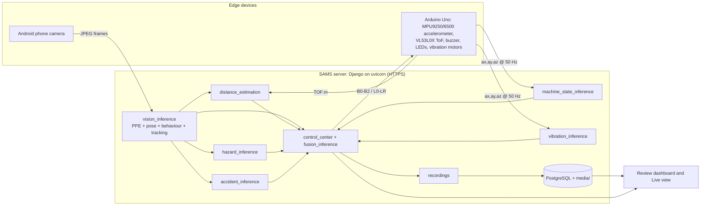

### How a decision is made

The service code only joins what the models measure. Every class name, threshold, image size, window length, zone limit and input order comes from the model's own `metadata.json`, so a retrained model drops in without code changes.

1. **People and gear.** The PPE checkpoint finds each person and their gear. Each class is kept above its own tuned threshold. Pose places joints inside each person box. Gear and fall boxes belong to the person box that holds their centre.
2. **Distance.** The person in the ToF beam gets the ToF reading, if it falls inside the calibrated near range. Everyone else gets the distance network's estimate.
3. **Motion.** Speed and approach are the slope of each tracked person's distances over the fusion model's `motion_window_s`.
4. **Machine.** The machine-state model labels the latest accelerometer window STOPPED or RUNNING. The vibration model gives P(ABNORMAL) for that window.
5. **Hazards.** The fire and smoke scores are the strongest boxes above their thresholds. The fall flag is set by a lying-person box.
6. **Fusion.** These values form the 14-input vector the fusion model was trained on. For an empty frame, the person inputs take the model's `absent_worker` values. Any input that was not measured means **no decision**, and the reason names what is missing; nothing is filled in.
7. **Actuation.** When the label changes, the buzzer and LEDs follow it and the change is logged.

| Fusion input | Source |
|---|---|
| `worker_detected`, `vision_confidence` | Person detector |
| `worker_distance`, `inside_caution_zone`, `inside_danger_zone` | ToF or distance network, and the model's `zones_m` |
| `worker_speed`, `approaching_machine` | Distance history of the tracked person |
| `ppe_missing` | PPE detector |
| `machine_active` | Machine-state model |
| `vibration_state`, `vibration_anomaly_score` | Vibration model |
| `fire_score`, `smoke_score` | Hazard detector |
| `fall_detected` | Fall detector |

---

## Technical requirements

| Layer | Requirement | Version |
|---|---|---|
| Language | Python | 3.12 (3.13+ unsupported: no torch 2.2.2 / numpy 1.26.4 wheels) |
| Web | Django, uvicorn (ASGI, HTTPS), django-cors-headers | 6.1.1, 0.54.0, 4.9.0 |
| Database | PostgreSQL through the Django ORM | 14+ (psycopg 3) |
| ML / CV | PyTorch, torchvision, Ultralytics YOLOv8, scikit-learn, XGBoost | 2.2.2, 0.17.2, 8.3+, 1.6.1, 3.4.1 |
| Data / media | NumPy, SciPy, OpenCV (headless), Pillow, imageio-ffmpeg | 1.26.4, 1.13.1, 4.10, 12.3, 0.6.0 |
| Hardware link | pyserial; arduino-cli for flashing | 3.5; 1.5+ |
| Frontend | Django templates, vanilla JavaScript, CSS | any current browser |
| Training | Google Colab (GPU), Jupyter | — |
| Server hardware | x86-64 or Apple Silicon, 8 GB RAM; GPU optional | tested on Intel i5-8259U, macOS 15 |
| Board | Arduino Uno (AVR, CH340 USB) with the parts in [Hardware](#hardware) | firmware in `hardware/firmware/` |
| Camera | Android phone with a browser that allows camera access over HTTPS | same Wi-Fi as the server |

Exact Python versions are pinned in [`requirements.txt`](requirements.txt).

---

## Quick start

### Prerequisites

- **Python 3.12.** Python 3.13+ will not work: `torch==2.2.2` and `numpy==1.26.4` have no wheels for it. On macOS, `brew install python@3.12`.
- **PostgreSQL 14+**, running locally (or reachable from the laptop). Defaults expect a database/user/password all named `sams` on `127.0.0.1:5432`.
- **OpenSSL**, for the self-signed HTTPS certificate (preinstalled on macOS and most Linux distributions).
- For live sensing: an Arduino Uno with the parts under [Hardware](#hardware), [`arduino-cli`](https://arduino.github.io/arduino-cli/), and an Android phone on the same Wi-Fi.

### Install

```bash
git clone https://github.com/Bonaparte003/Smart-Accident-System-Monitoring-SAMS-.git
cd Smart-Accident-System-Monitoring-SAMS-

python3.12 -m venv myenv
source myenv/bin/activate
pip install --upgrade pip
pip install -r requirements.txt
```

Create the database once (Homebrew example; adjust if your Postgres install differs):

```bash
brew install postgresql@16
brew services start postgresql@16
createuser -s sams 2>/dev/null || true
psql postgres -c "ALTER USER sams WITH PASSWORD 'sams';" 2>/dev/null || \
  psql postgres -c "CREATE USER sams WITH PASSWORD 'sams' CREATEDB;"
psql postgres -c "CREATE DATABASE sams OWNER sams;" 2>/dev/null || true
```

Or with Docker:

```bash
docker run -d --name sams-postgres -e POSTGRES_USER=sams -e POSTGRES_PASSWORD=sams \
  -e POSTGRES_DB=sams -p 5432:5432 postgres:16
```

Then migrate and create an admin user:

```bash
python manage.py migrate
python manage.py createsuperuser
```

### Models

Trained weights (about 1.2 GB) are kept out of git. Place them under `models/`, or retrain them with the notebooks (see [Retraining](#retraining-mlops)).

| Model | Path |
|---|---|
| Fusion | `models/fusion/best_fusion_model/` (`model.joblib`, `metadata.json`) |
| Vibration | `models/vibration/best/` |
| Machine state | `models/machine_state/` (`model.joblib`, `metadata.json`) |
| PPE | `models/vision/ppe/` (`best.pt`, `metadata.json`) |
| Fire / smoke | `models/vision/hazard/` (`best.pt`, `metadata.json`) |
| Fall | `models/vision/accident/` (`best.pt`, `metadata.json`) |
| Pose | `models/vision/pose/` (`best.pt`, `metadata.json`) |
| Distance | `models/vision/distance/` (`distance_nn.pt`, `calib.json`) |

The app starts with any subset of models. A missing model shows as unavailable, and fusion gives no decision until every input it needs is measured.

### Run

Video upload analysis and live-session encoding run on **Celery** (Redis broker). Start Redis, then the worker, then the web app:

```bash
brew services start redis
./scripts/celery_worker.sh
python manage.py runserver
```

On macOS use **`--pool=solo`** (the helper does this). The default prefork pool crashes with Django/PyTorch (`not enough values to unpack` in billiard). If Redis or the worker is down, SAMS falls back to a local thread so a demo still finishes.

`runserver` is overridden in `manage.py`. It creates a self-signed certificate if needed and starts **uvicorn over HTTPS** on `0.0.0.0:8000`. HTTPS is required because phone browsers block the camera on plain HTTP.

```text
SAMS is starting with uvicorn (HTTPS):
  Mac:   https://127.0.0.1:8000/
  Phone: https://192.168.x.x:8000/  (camera needs HTTPS)
```

With the Arduino connected, use the helper. It sets the serial port and HTTPS mode:

```bash
export SAMS_HW_SERIAL_PORT=/dev/cu.usbserial-1410
./hardware/tools/hw.sh run
```

Without the board, the dashboard and the phone camera still work (people, PPE, hazards, falls, distance). Machine state and vibration show as offline, so fusion gives no decision.

---

## Configuration

Every variable has a default; none is needed for a first run.

| Variable | Default | Purpose |
|---|---|---|
| `DJANGO_SECRET_KEY` | development key | **Set in production** |
| `DJANGO_DEBUG` | `true` | Set to `false` in production |
| `DJANGO_ALLOWED_HOSTS` | `*` | Comma-separated host names |
| `SAMS_DB_NAME` | `sams` | PostgreSQL database name |
| `SAMS_DB_USER` | `sams` | PostgreSQL user |
| `SAMS_DB_PASSWORD` | `sams` | PostgreSQL password |
| `SAMS_DB_HOST` | `127.0.0.1` | PostgreSQL host |
| `SAMS_DB_PORT` | `5432` | PostgreSQL port |
| `SAMS_DB_CONN_MAX_AGE` | `60` | Persistent DB connections (seconds); `0` disables |
| `CELERY_BROKER_URL` | `redis://127.0.0.1:6379/1` | Celery / Redis broker (DB **1**, so it does not share DB 0 with other apps) |
| `CELERY_RESULT_BACKEND` | same as broker | Celery result store |
| `SAMS_CELERY_EAGER` | `false` | Run tasks in-process (no worker; used by tests) |
| `SAMS_MEDIA_ROOT` | `media/` | Recorded videos and frames |
| `SAMS_HW_SERIAL_PORT` | first USB serial device | Arduino port, e.g. `/dev/cu.usbserial-1410` |
| `SAMS_HW_SERIAL_BAUD` | `115200` | Serial speed |
| `SAMS_HW_BUZZER_ENABLED` / `SAMS_HW_BUZZER_AUTO` | `true` | Enable the buzzer / follow the risk level |
| `SAMS_HW_LEDS_ENABLED` / `SAMS_HW_LEDS_AUTO` | `true` | Enable the LEDs / follow the risk level |
| `SAMS_HW_TOF_M` | unset | Lab only: a fixed near-range distance in place of the ToF |
| `SAMS_HW_TOF_STALE_S` | `2.0` | Seconds a ToF reading stays usable |
| `SAMS_HTTPS` | set by `hw.sh run` | Makes the phone QR code use `https://` |
| `SAMS_PUBLIC_BASE` / `SAMS_PUBLIC_HOST` | LAN IP | Override the address in the phone QR code |
| `SAMS_VISION_POSE`, `SAMS_VISION_PPE`, `SAMS_VISION_HAZARD` | on | Set `false` to switch a vision model off |
| `SAMS_VIDEO_ANALYSIS_FPS` | `2` | Frames per second analysed in an uploaded clip |
| `SAMS_PPE_WEIGHTS`, `SAMS_POSE_WEIGHTS`, `SAMS_HAZARD_WEIGHTS`, `SAMS_ACCIDENT_WEIGHTS`, `SAMS_DISTANCE_WEIGHTS` | `models/…` | Override a weights path |

Sample rate and window length are not configured here: each accelerometer model's metadata states the rate and window it was trained on, and the stream serves each model its own window.

---

## Using the app

Everything is in the review dashboard (sign-in required).

| Page | URL | Purpose |
|---|---|---|
| Home | `/` | CAUTION / DANGER trends, device health, storage, **Go Live** |
| Live | `/live/` | Annotated phone frame, decision, distance, machine, vibration, PPE, motor controls |
| Archive | `/archive/` | Live sessions and uploaded clips; **Upload video** |
| Recording | `/recordings/<id>/` | Framed video with timestamped log cards |
| Alerts | `/alerts/` | Live decision changes and archived problem moments |
| MLOps | `/mlops/` | Models in service, review queue, data-collection trials, training-set export |

### Demo flow

1. Sign in and check device health on **Home**.
2. Press **Go Live** and scan the QR code with the phone. Accept the certificate warning, allow the camera, then press **View video**.
3. Start the machine from the Live page's **Machine** buttons. The machine-state model switches to RUNNING.
4. Walk toward the camera. The zone goes from clear to caution (≤ 2.0 m) to danger (≤ 0.8 m), and the decision, buzzer and LEDs follow.
5. Review the session in **Alerts** and **Archive**, then label its moments in **MLOps**.

---

## Hardware

Pin-level details, the serial protocol and recording tools are in [`hardware/README.md`](hardware/README.md).

### Schematic


The firmware ([`mpu6050_serial.ino`](hardware/firmware/mpu6050_serial/mpu6050_serial.ino)) is the reference for pin numbers; the table below is taken from it. The sketch folder name is historical; SAMS uses an **MPU9250/6500** module (and still accepts related InvenSense parts that share the same accel registers).

| Arduino pin | Connects to | Notes |
|---|---|---|
| A2 / A3 | Accelerometer SDA / SCL | Software I2C. MPU9250 / MPU6500 (also MPU6050 / MPU9255). The board reports the chip at boot |
| A0 / A1 | VL53L0X SDA / SCL | Software I2C; leave XSHUT open |
| 5V / GND | Accelerometer and ToF power | Common ground for every part |
| D2 / D3 / D5 | Green / yellow / red LED anodes | Each through a series resistor (220 Ω–1 kΩ), cathode to GND |
| D8 | Buzzer + | Active buzzer; use a transistor if D8 cannot drive it |
| D9 | 330 Ω → 2N2222A base | Switches the vibration motors that simulate a running machine |
| — | 2 × DC vibration motors | Between the battery + and the 2N2222A collector, each with a 1N4007 flyback diode; emitter to GND |
| — | 2 × AAA (≈ 3 V) | Motor supply; its − joins the Arduino GND |

### Bill of materials

| Part | Qty | Role |
|---|---|---|
| Arduino Uno (AVR + CH340) | 1 | Reads sensors, drives actuators, USB serial at 115200 baud |
| MPU9250 / MPU6500 module | 1 | Machine vibration and machine state, 50 Hz |
| VL53L0X time-of-flight module | 1 | Close-range worker distance |
| Active buzzer | 1 | Audible caution / danger patterns |
| LEDs (green, yellow, red) + resistors | 3 | Visual risk level |
| DC vibration motors | 2 | Simulated machine |
| 2N2222A NPN transistor, 330 Ω resistor | 1 each | Motor driver |
| 1N4007 diodes | 2 | Flyback protection |
| 2 × AAA battery holder | 1 | Motor supply |
| Android phone | 1 | Live camera over Wi-Fi |

### Helper commands

```bash
./hardware/tools/hw.sh ports            # list connected boards
./hardware/tools/hw.sh flash            # compile and upload the main firmware
./hardware/tools/hw.sh check            # verify accelerometer, ToF and actuators
./hardware/tools/hw.sh test-leds        # LED cycle
./hardware/tools/hw.sh coverage --next  # what STOPPED/RUNNING takes are still missing
./hardware/tools/hw.sh record-steady --disturbance quiet   # machine STOPPED (quiet|bumps|footsteps)
./hardware/tools/hw.sh record-running --motor low   # machine RUNNING (repeat per motor level)
./hardware/tools/hw.sh certs            # regenerate the HTTPS certificate after an IP change
./hardware/tools/hw.sh run              # start SAMS with the board
```

---

## Machine-learning models

Each model is trained, evaluated and documented in its own Colab notebook. Every notebook splits by recording, trial, video or subject so that no near-duplicate sits on both sides of a split, picks its winner on **validation**, and reports **test** once.

| # | Notebook | Served model | Headline result (test) |
|---|---|---|---|
| 01 | Safe / unsafe behaviour | ResNet18, fine-tuned (live single-frame) | Binary accuracy 0.76, unsafe recall 0.85; video-clip winner kept for research |
| 02 | Vibration | SVM (RBF) on 48 window features, UCI accelerometer data | Macro-F1 0.80 (validation 0.86) |
| 02 §8 | Machine state | Random Forest on magnitude features, SAMS board recordings | STOPPED and RUNNING recall 1.0 on held-out windows |
| 03 | Fusion risk | Random Forest, 14 inputs | DANGER recall 1.0, macro-F1 0.997; all 15 scenario checks pass |
| 04 | Distance | Pinhole estimate × learned residual MLP | Mean error 0.22 m on an unseen person (pinhole alone 0.79 m) |
| 05 | PPE | YOLOv8n, 640 px | mAP50-95 0.235 (validation 0.333) |
| 06 | Fire / smoke | YOLOv8s, 960 px | mAP50-95 0.394; fire found in 98.9% of fire frames (validation) |
| 07 | Fall | YOLOv8s, 640 px | 17 / 17 falls found, no false falls on the test set |
| 08 | Pose | YOLOv8s-pose, fine-tuned | Joint accuracy (PCK) 0.854 vs 0.767 for stock YOLOv8n-pose |

Figures, ledgers and metric tables are written to `results/`. Read the headline numbers together with the [limitations](#known-limitations-and-roadmap).

---

## Retraining (MLOps)

Real site data comes from two places:

- **Archive moments.** Each log card keeps the clean frame, every model's output and the exact fusion inputs. In **MLOps → Review queue**, set the true risk level and **Keep** or **Exclude** each one.
- **Trials.** In **MLOps → Data collection**, start a trial with the scene's true risk level and act it out live. Every fully measured second is kept under that label, together with ToF-labelled distance rows.

Then:

1. Press **Download training set** and unzip it into `MyDrive/SAMS/`. It holds `datasets/fusion/fusion_experiment_logs.csv` (notebook 03 trains on it instead of synthetic scenarios) and `datasets/vision/distance/site_labels.csv` (notebook 04 fine-tunes on it).
2. Run the notebook in Colab.
3. Copy the promoted model folder into `models/` and restart. The service reads the new contract from `metadata.json`.

Retrain **fusion last**: notebook 03 reads the hazard model's thresholds and must match the other models' outputs.

The vision notebooks also pick up optional data from `MyDrive/SAMS/` when it is there, and run without it:

| Folder | Notebook | Contents |
|---|---|---|
| `datasets/vision/accident/extra/<name>/` | 07 Fall | A real fall dataset in YOLO format with its `data.yaml` (for example a Roboflow export); class names are mapped onto `laying` / `standing` |
| `datasets/vision/accident/site/` | 07 Fall | Labelled SAMS frames, same layout: staged falls and normal work |
| `datasets/vision/ppe/site/{train,val,test}/` | 05 PPE | Labelled SAMS frames in the 12-class PPE list, split by recording |
| `datasets/vision/{accident,ppe}/background/` | 05, 07 | Empty SAMS frames, added to training as background |

---

## API

JSON endpoints share the server. Device-facing POST endpoints are CSRF-exempt. Use `curl -k` because the certificate is self-signed.

| Method | Endpoint | Description |
|---|---|---|
| GET | `/api/health/` | Status of every loaded model |
| GET | `/api/control/live/` | Classify the latest frame, read the board, run fusion, drive the actuators |
| GET | `/api/hardware/status/` | Board, buzzer, LEDs, camera and ToF status |
| GET · POST | `/api/hardware/camera/` | Phone QR session status, or `{ "action": "start" \| "stop" }` |
| GET | `/cam/<token>/` | Phone join page opened from the QR code |
| POST | `/cam/<token>/join/`, `/cam/<token>/frame/` | Phone joins, then uploads JPEG frames |

```bash
curl -k https://127.0.0.1:8000/api/health/
```

---

## Database schema

Defined in [`monitoring/models.py`](monitoring/models.py). Users and sessions use Django's built-in `auth` tables.

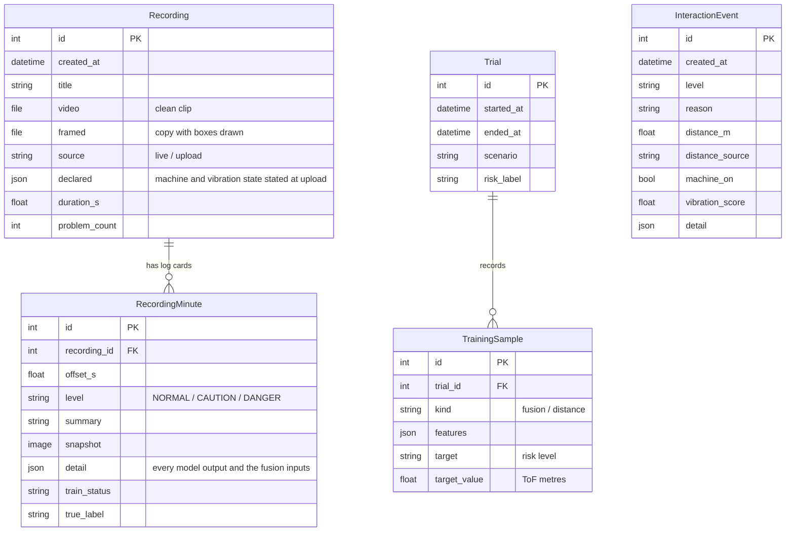

- **Recording / RecordingMinute:** each archived clip and its log cards; the review pages and the MLOps export read from them.
- **InteractionEvent:** one row per live decision change (audit trail).
- **Trial / TrainingSample:** a staged data-collection session and the rows it logged under its label.

---

## Project structure

```text
SAMS/
├── SAMS/                        Django project: settings, urls, asgi
├── monitoring/                  Main app
│   ├── services/                One module per model, plus fusion, tracking, recordings, MLOps
│   │   ├── model_loader.py      Shared lazy, thread-safe loading (LazyModel → JoblibModel, YoloModel)
│   │   ├── control_center.py    Joins every measurement into the fusion decision
│   │   └── *_inference.py       PPE, pose, hazard, fall, distance, vibration, machine state, fusion
│   ├── management/commands/     `benchmark`: per-model latency on this machine
│   ├── templates/monitoring/    Review dashboard and phone camera pages
│   ├── static/monitoring/
│   ├── models.py
│   ├── views.py                 Live decision, phone camera and health API
│   ├── review_views.py          Dashboard pages
│   └── tests/                   Test modules by area, and shared fixtures
├── hardware/                    Serial stream, buzzer, LEDs, motor, ToF, phone camera
│   ├── firmware/                Arduino sketches
│   └── tools/                   hw.sh, recording and check scripts
├── notebooks/                   Eight Colab training notebooks
├── models/                      Trained weights and metadata (not in git)
├── results/                     Notebook figures and metrics; performance/ from `benchmark`
├── stead_dataset/mpu6050/       Board recordings for the machine-state model (folder name historical; sensor is MPU9250/6500)
├── docs/                        Technical report
├── Design/                      Schematic and UI screenshots
├── requirements.txt
└── manage.py                    `runserver` starts uvicorn over HTTPS
```

---

## Code design

| Principle | Where |
|---|---|
| **Abstraction and inheritance** | `LazyModel` (abstract) defines how a model is loaded once and shared; `JoblibModel`, `YoloModel`, `PoseModel` and `DistanceNet` only implement `load()`. `AccelSource` (abstract) is implemented by `SerialMPU6050` (serial reader for the MPU9250/6500 board) |
| **Polymorphism** | Every service calls `get()` / `reset()` the same way whatever the model type; `AccelStream` reads any `AccelSource` |
| **Encapsulation** | `Buzzer`, `Leds`, `Motor`, `ToFSensor`, `BoardPresence` and `PhoneCamera` own their state and serial commands; `MotionLog` owns per-person distance histories; `LiveRecorder` owns a session's frames and cards |
| **Separation of concerns** | Views call services; services never render HTML; hardware drivers know nothing about models |
| **Open for extension** | Thresholds, classes, image sizes, window lengths and input order come from each model's `metadata.json`, so a retrained model is a drop-in replacement with no code change |
| **Thread safety** | Double-checked locking in `LazyModel`; the accelerometer buffer is guarded by a lock |

**Algorithms:**
- ByteTrack for person tracking.
- Each gear box goes to the person box that contains its centre.
- Speed and approach are a least-squares slope (`np.polyfit`) over a time window of distances.
- Distance is a pinhole estimate times a learned residual, Z = Z0·e^δ, from an MLP trained with Huber loss.
- Detection thresholds are tuned per class on validation data to reach a target recall.
- Vibration uses 48 time- and frequency-domain features per window.
- Hazard scores are smoothed over a moving window.
- Training splits are leakage-free, by recording, trial, video or subject.

---

## Testing

| Strategy | What it checks | How to run | Result |
|---|---|---|---|
| **Unit** | Decision logic: PPE items and thresholds, box assignment, ToF beam, motion slopes, vibration features, fusion inputs, model loader | `python manage.py test monitoring` | 57 tests, all passing |
| **Integration** | Database, files and services together: live session → archive, uploaded clip → fusion, trials → export that matches the notebooks | same command (Django `TestCase`) | passing |
| **Model validation** | Leakage-free splits, selection on validation, test reported once; 15 fusion scenario checks; leave-one-recording-out for machine state | the notebooks | see [models](#machine-learning-models) |
| **Hardware** | Accelerometer, ToF and actuators answer; recordings pass rate, gravity and constant-signal checks | `hw.sh check`, `hw.sh record-*` | see [`hardware/README.md`](hardware/README.md) |
| **Performance** | Latency for each model and for a full frame, plus peak memory | `python manage.py benchmark` | below |

Test modules in `monitoring/tests/`: `test_vision`, `test_fusion`, `test_board`, `test_archive`, `test_model_loader`.

### Performance

From `python manage.py benchmark` on the MVP server: Intel Core i5-8259U, 8 GB RAM, CPU only, macOS 15, Python 3.12, PyTorch 2.2.2, 1280×720 frame. Results are written to `results/performance/`.

| Stage | Median latency |
|---|---|
| PPE + person (YOLOv8n, 640 px) | 76 ms |
| Pose (YOLOv8s-pose) | 169 ms |
| Fire / smoke (YOLOv8s, 960 px) | 289 ms |
| Fall (YOLOv8s) | 153 ms |
| **Full frame, every vision model + distance** | **636 ms ≈ 1.6 frames/s** |
| Fusion | 50 ms |
| Machine state / vibration window | 46 / 6 ms |
| Peak memory | ≈ 710 MB |

The fire/smoke detector is the bottleneck. Running it on every second frame, exporting the detectors to ONNX/OpenVINO, or moving to a GPU edge device are the planned speed-ups.

---

## Deployment

SAMS runs **on site, next to the machine**: video stays in the workshop, alerts don't depend on the internet, and the buzzer reacts in real time.

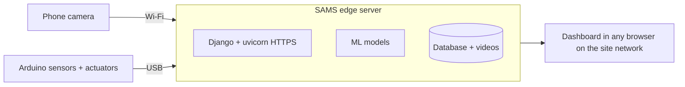

It runs on a laptop on the local Wi-Fi: `python manage.py runserver` starts everything; PostgreSQL and `media/` store the data.

**Model updates are drop-in:** copy the new model folder into `models/` and restart.


---

## Known limitations and roadmap

SAMS is an MVP. The headline numbers above come from public or synthetic data and need to be confirmed on site.

| Area | Limitation | Next step |
|---|---|---|
| Per-frame decisions | One wrong fire, fall or PPE box on one frame can raise DANGER | Require a detection to persist over several frames, with the count stored in each model's metadata |
| Fusion | Trained on synthetic, rule-labelled scenarios, so its scores show it learned the rules | Retrain on reviewed archive moments and trials |
| Fall | 111 synthetic images, all containing a fall; the false-fall rate on normal scenes is unmeasured, and crouching workers have been flagged | Add real standing, bending and crouching scenes and staged falls |
| Fire / smoke | 5% of empty frames raise fire; sunlit metal has been flagged | Add site background frames; raise the fire threshold |
| PPE | Missing-gear recall drops from 0.45 (validation) to 0.05 (test); boots are weak | More real site images; choose thresholds by F1 |
| Vibration | Trained on UCI data; on the SAMS board it outputs a near-constant score | Train on the SAMS board: healthy-only anomaly model first, then recorded faults |
| Machine state | A speed left out of training is missed | Record every motor speed and more stopped sessions with disturbances |
| Distance | No training data below 1.8 m; the phone camera differs from the dataset's | Fine-tune on ToF-labelled site rows |
| Behaviour | Trained on one public facility; whole-frame labels miss authorisation context | Retrain on reviewed SAMS archive frames |

---

## Designs and screenshots

All screens are in [`Design/`](Design/).

| | |
|---|---|
| **Sign in**<br/>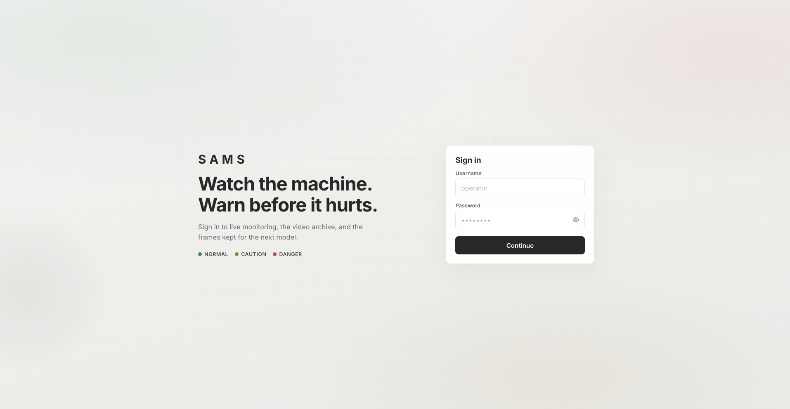 | **Go Live (phone QR)**<br/>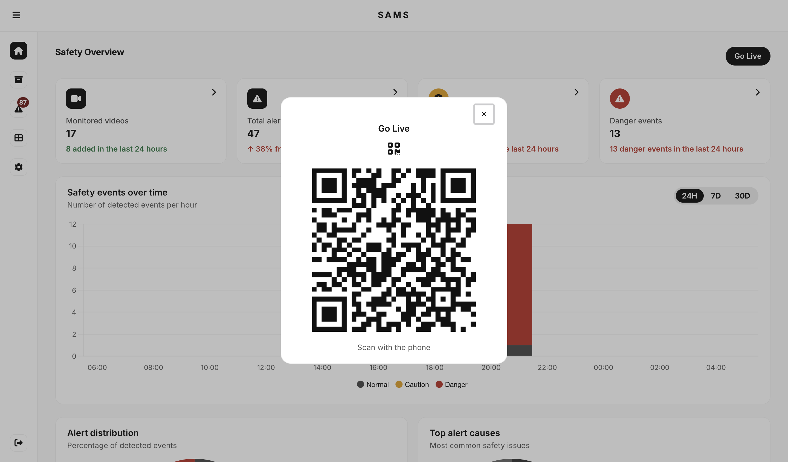 |
| **Safety overview**<br/>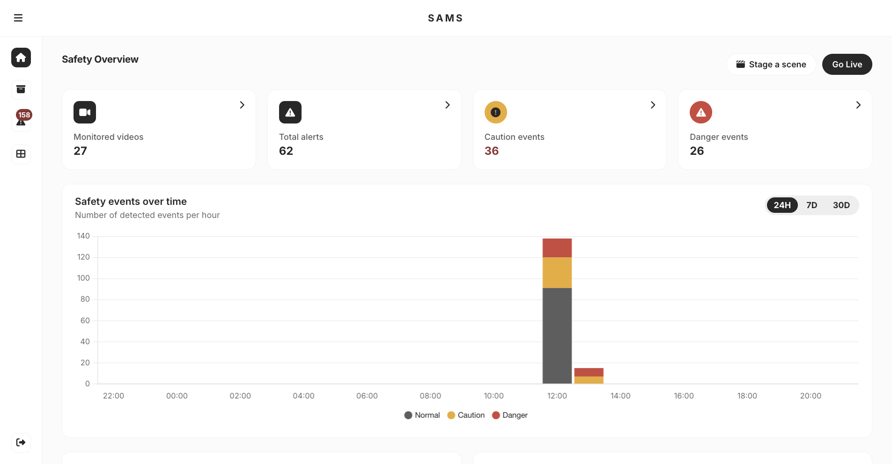 | **Overview, lower half**<br/>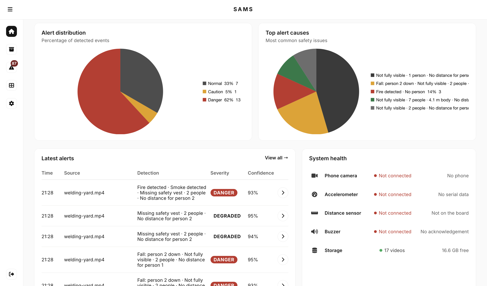 |
| **Alerts**<br/>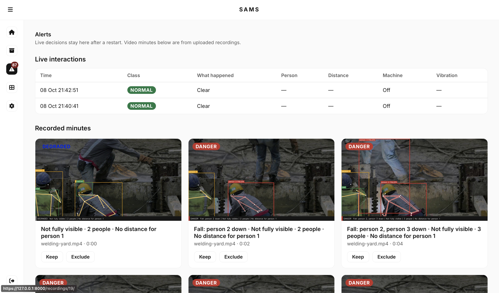 | **Archive**<br/>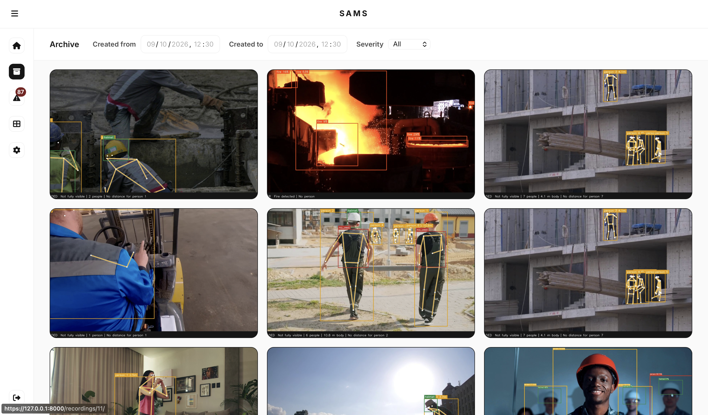 |
| **Recording view**<br/>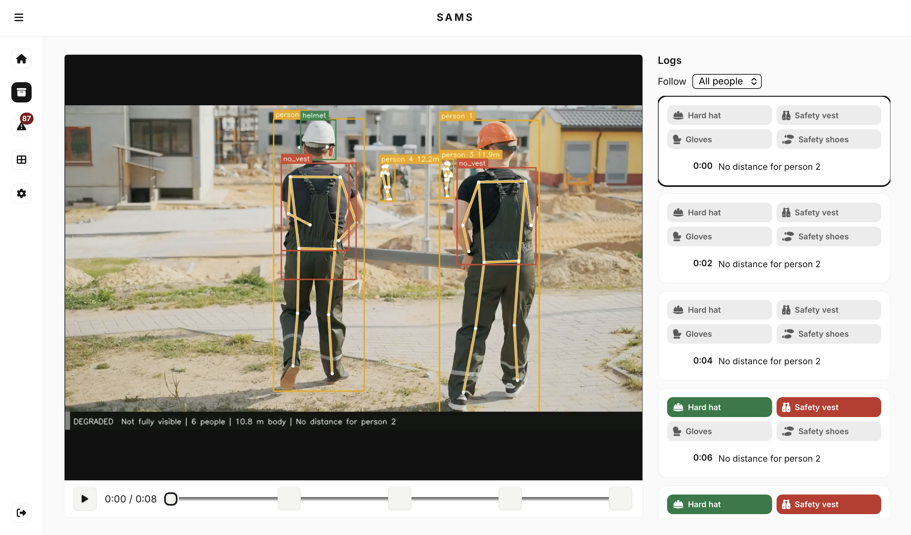 | **MLOps and retraining**<br/>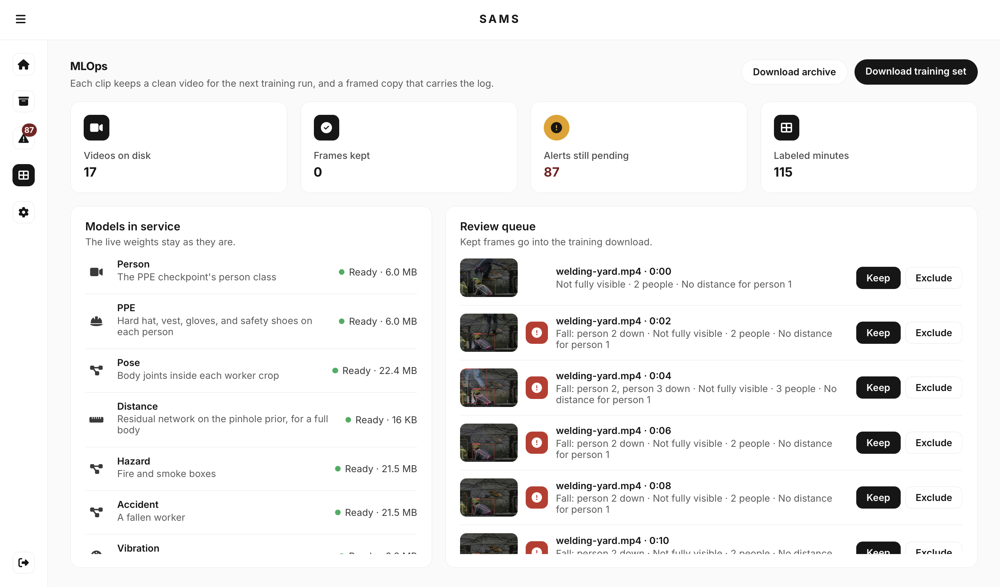 |

**Design principles**

- **One place.** The operator watching the machine and the safety officer use the same dashboard.
- **One decision, always visible.** Colour plus a label, so it reads at a glance without relying on colour alone.
- **Plain language.** NORMAL / CAUTION / DANGER, or "No decision" with what was not measured.
- **Responsive.** The rail collapses to icons; the phone camera page is mobile-first.
