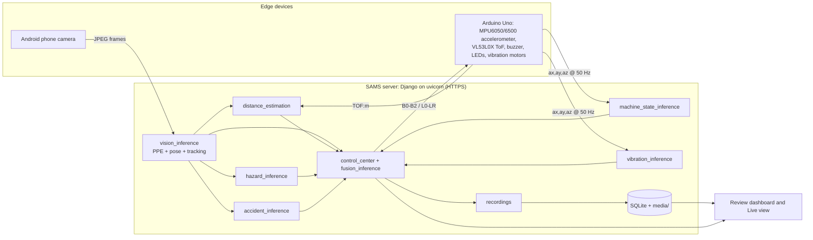
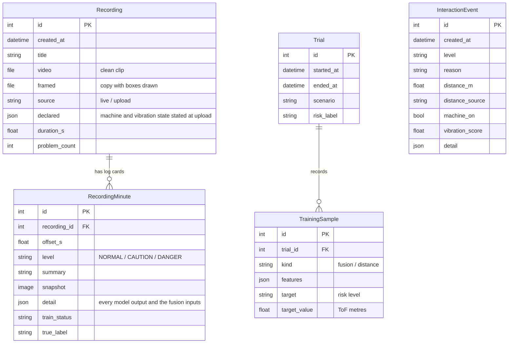
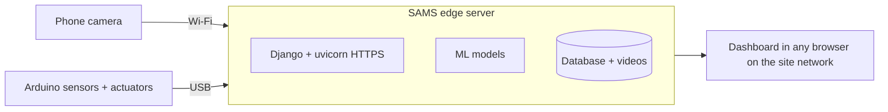

# SAMS — Smart Accident Monitoring System


SAMS warns workers **before** they get hurt near industrial machines. A phone camera watches the machine area and an accelerometer sits on the machine. Machine-learning models find each worker, estimate their distance to the machine, check their protective gear, and look for fire, smoke and falls. Other models read whether the machine is running and whether it vibrates abnormally. A fusion model turns all of it into one risk level, **NORMAL**, **CAUTION** or **DANGER**, and drives a buzzer and warning LEDs in real time.

Every live session is archived with the decision for each moment. Uploaded videos go through the same pipeline. A safety officer reviews those moments, and the reviewed moments become the training data for the next model.

| | |
|---|---|
| **Repository** | <https://github.com/Bonaparte003/Smart-Accident-System-Monitoring-SAMS-> |
| **Video demo** | <https://www.youtube.com/watch?v=tkwJFKNSVD8> |
| **Track** | ML track (models, notebooks, metrics) with a full-stack web MVP and hardware integration |
| **Training** | Eight Colab notebooks in [`notebooks/`](notebooks/), one per model |

---

## Contents

1. [Features](#features)
2. [System architecture](#system-architecture)
3. [Quick start](#quick-start)
4. [Configuration](#configuration)
5. [Using the app](#using-the-app)
6. [Hardware](#hardware)
7. [Machine-learning models](#machine-learning-models)
8. [Retraining (MLOps)](#retraining-mlops)
9. [API](#api)
10. [Database schema](#database-schema)
11. [Project structure](#project-structure)
12. [Testing](#testing)
13. [Deployment](#deployment)
14. [Security notes](#security-notes)
15. [Known limitations and roadmap](#known-limitations-and-roadmap)
16. [Designs and screenshots](#designs-and-screenshots)

---

## Features

| Feature | What it does |
|---|---|
| **Live risk decision** | The fusion model combines 14 measured inputs into NORMAL / CAUTION / DANGER on every frame |
| **Phone camera** | An Android phone joins by scanning the **Go Live** QR code and streams frames over Wi-Fi (HTTPS) |
| **Worker distance** | A VL53L0X time-of-flight sensor measures close range; a pose-based neural network estimates everyone else |
| **Worker motion** | Speed and approach are measured from each tracked worker's distance history |
| **PPE check** | Hard hat, vest, gloves, boots and goggles per worker, each with its own tuned threshold |
| **Fire, smoke and falls** | YOLOv8 detectors for fire and smoke, and for a worker lying on the floor |
| **Machine state** | The accelerometer on the machine tells STOPPED from RUNNING |
| **Vibration monitoring** | Each accelerometer window is labelled NORMAL or ABNORMAL |
| **Alerts on hardware** | Buzzer patterns and green / yellow / red LEDs follow the risk level |
| **Live recording** | Every Go Live session is archived: the clean video plus a log card every 2 s and at every decision change |
| **Video upload** | Analyse a clip with the same models; the operator declares the machine and vibration state the board would have read |
| **Alerts page** | Every live CAUTION / DANGER change and every problem moment in the archive |
| **MLOps desk** | Model inventory, review queue for archived moments, labelled data-collection trials, and a training-set export |

---

## System architecture



### How a decision is made

The service code only joins what the models measure. Every class name, threshold, image size, window length, zone limit and input order comes from the model's own `metadata.json`, so a retrained model drops in without code changes.

1. **People and gear.** The PPE checkpoint finds each person and their gear. Each class is kept above its own tuned threshold. Pose places joints inside each person box. Gear and fall boxes belong to the person box that holds their centre.
2. **Distance.** The person in the ToF beam gets the ToF reading, if it falls inside the calibrated near range. Everyone else gets the distance network's estimate.
3. **Motion.** Speed and approach are the slope of each tracked person's distances over the fusion model's `motion_window_s`.
4. **Machine.** The machine-state model labels the latest accelerometer window STOPPED or RUNNING. The vibration model gives P(ABNORMAL) for that window.
5. **Hazards.** The fire and smoke scores are the strongest boxes above their thresholds. The fall flag is set by a lying-person box.
6. **Fusion.** These values form the 14-input vector the fusion model was trained on. For an empty frame, the person inputs take the model's `absent_worker` values. Any input that was not measured means **no decision**, and the reason names what is missing; nothing is filled in.
7. **Actuation.** When the label changes, the buzzer and LEDs follow it and the change is logged.

| Fusion input | Source |
|---|---|
| `worker_detected`, `vision_confidence` | Person detector |
| `worker_distance`, `inside_caution_zone`, `inside_danger_zone` | ToF or distance network, and the model's `zones_m` |
| `worker_speed`, `approaching_machine` | Distance history of the tracked person |
| `ppe_missing` | PPE detector |
| `machine_active` | Machine-state model |
| `vibration_state`, `vibration_anomaly_score` | Vibration model |
| `fire_score`, `smoke_score` | Hazard detector |
| `fall_detected` | Fall detector |

---

## Quick start

### Prerequisites

- **Python 3.12.** Python 3.13+ will not work: `torch==2.2.2` and `numpy==1.26.4` have no wheels for it. On macOS, `brew install python@3.12`.
- **OpenSSL**, for the self-signed HTTPS certificate (preinstalled on macOS and most Linux distributions).
- For live sensing: an Arduino Uno with the parts under [Hardware](#hardware), [`arduino-cli`](https://arduino.github.io/arduino-cli/), and an Android phone on the same Wi-Fi.

### Install

```bash
git clone https://github.com/Bonaparte003/Smart-Accident-System-Monitoring-SAMS-.git
cd Smart-Accident-System-Monitoring-SAMS-

python3.12 -m venv myenv
source myenv/bin/activate            # Windows: myenv\Scripts\activate
pip install --upgrade pip
pip install -r requirements.txt

python manage.py migrate
python manage.py createsuperuser     # account for the review dashboard
```

### Models

Trained weights (about 1.2 GB) are kept out of git. Place them under `models/`, or retrain them with the notebooks (see [Retraining](#retraining-mlops)).

| Model | Path |
|---|---|
| Fusion | `models/fusion/best_fusion_model/` (`model.joblib`, `metadata.json`) |
| Vibration | `models/vibration/best/` |
| Machine state | `models/machine_state/` (`model.joblib`, `metadata.json`) |
| PPE | `models/vision/ppe/` (`best.pt`, `metadata.json`) |
| Fire / smoke | `models/vision/hazard/` (`best.pt`, `metadata.json`) |
| Fall | `models/vision/accident/` (`best.pt`, `metadata.json`) |
| Pose | `models/vision/pose/` (`best.pt`, `metadata.json`) |
| Distance | `models/vision/distance/` (`distance_nn.pt`, `calib.json`) |

The app starts with any subset of models. A missing model shows as unavailable, and fusion gives no decision until every input it needs is measured.

### Run

```bash
python manage.py runserver
```

`runserver` is overridden in `manage.py`. It creates a self-signed certificate if needed and starts **uvicorn over HTTPS** on `0.0.0.0:8000`. HTTPS is required because phone browsers block the camera on plain HTTP.

```text
SAMS is starting with uvicorn (HTTPS):
  Mac:   https://127.0.0.1:8000/
  Phone: https://192.168.x.x:8000/  (camera needs HTTPS)
```

With the Arduino connected, use the helper. It sets the serial port and HTTPS mode:

```bash
export SAMS_HW_SERIAL_PORT=/dev/cu.usbserial-1410
./hardware/tools/hw.sh run
```

Without the board, the dashboard and the phone camera still work (people, PPE, hazards, falls, distance). Machine state and vibration show as offline, so fusion gives no decision.

---

## Configuration

Every variable has a default; none is needed for a first run.

| Variable | Default | Purpose |
|---|---|---|
| `DJANGO_SECRET_KEY` | development key | **Set in production** |
| `DJANGO_DEBUG` | `true` | Set to `false` in production |
| `DJANGO_ALLOWED_HOSTS` | `*` | Comma-separated host names |
| `SAMS_DB_PATH` | `db.sqlite3` | SQLite file |
| `SAMS_MEDIA_ROOT` | `media/` | Recorded videos and frames |
| `SAMS_HW_SERIAL_PORT` | first USB serial device | Arduino port, e.g. `/dev/cu.usbserial-1410` |
| `SAMS_HW_SERIAL_BAUD` | `115200` | Serial speed |
| `SAMS_HW_BUZZER_ENABLED` / `SAMS_HW_BUZZER_AUTO` | `true` | Enable the buzzer / follow the risk level |
| `SAMS_HW_LEDS_ENABLED` / `SAMS_HW_LEDS_AUTO` | `true` | Enable the LEDs / follow the risk level |
| `SAMS_HW_TOF_M` | unset | Lab only: a fixed near-range distance in place of the ToF |
| `SAMS_HW_TOF_STALE_S` | `2.0` | Seconds a ToF reading stays usable |
| `SAMS_HTTPS` | set by `hw.sh run` | Makes the phone QR code use `https://` |
| `SAMS_PUBLIC_BASE` / `SAMS_PUBLIC_HOST` | LAN IP | Override the address in the phone QR code |
| `SAMS_VISION_POSE`, `SAMS_VISION_PPE`, `SAMS_VISION_HAZARD` | on | Set `false` to switch a vision model off |
| `SAMS_VIDEO_ANALYSIS_FPS` | `2` | Frames per second analysed in an uploaded clip |
| `SAMS_PPE_WEIGHTS`, `SAMS_POSE_WEIGHTS`, `SAMS_HAZARD_WEIGHTS`, `SAMS_ACCIDENT_WEIGHTS`, `SAMS_DISTANCE_WEIGHTS` | `models/…` | Override a weights path |

Sample rate and window length are not configured here: each accelerometer model's metadata states the rate and window it was trained on, and the stream serves each model its own window.

---

## Using the app

Everything is in the review dashboard (sign-in required).

| Page | URL | Purpose |
|---|---|---|
| Home | `/` | CAUTION / DANGER trends, device health, storage, **Go Live** |
| Live | `/live/` | Annotated phone frame, decision, distance, machine, vibration, PPE, motor controls |
| Archive | `/archive/` | Live sessions and uploaded clips; **Upload video** |
| Recording | `/recordings/<id>/` | Framed video with timestamped log cards |
| Alerts | `/alerts/` | Live decision changes and archived problem moments |
| MLOps | `/mlops/` | Models in service, review queue, data-collection trials, training-set export |

### Demo flow

1. Sign in and check device health on **Home**.
2. Press **Go Live** and scan the QR code with the phone. Accept the certificate warning, allow the camera, then press **View video**.
3. Start the machine from the Live page's **Machine** buttons. The machine-state model switches to RUNNING.
4. Walk toward the camera. The zone goes from clear to caution (≤ 2.0 m) to danger (≤ 0.8 m), and the decision, buzzer and LEDs follow.
5. Review the session in **Alerts** and **Archive**, then label its moments in **MLOps**.

---

## Hardware

Pin-level details, the serial protocol and recording tools are in [`hardware/README.md`](hardware/README.md).

### Schematic


The firmware ([`mpu6050_serial.ino`](hardware/firmware/mpu6050_serial/mpu6050_serial.ino)) is the reference for pin numbers; the table below is taken from it.

| Arduino pin | Connects to | Notes |
|---|---|---|
| A2 / A3 | Accelerometer SDA / SCL | Software I2C. MPU6050, MPU6500, MPU9250 and MPU9255 all work; the board reports the chip at boot |
| A0 / A1 | VL53L0X SDA / SCL | Software I2C; leave XSHUT open |
| 5V / GND | Accelerometer and ToF power | Common ground for every part |
| D2 / D3 / D5 | Green / yellow / red LED anodes | Each through a series resistor (220 Ω–1 kΩ), cathode to GND |
| D8 | Buzzer + | Active buzzer; use a transistor if D8 cannot drive it |
| D9 | 330 Ω → 2N2222A base | Switches the vibration motors that simulate a running machine |
| — | 2 × DC vibration motors | Between the battery + and the 2N2222A collector, each with a 1N4007 flyback diode; emitter to GND |
| — | 2 × AAA (≈ 3 V) | Motor supply; its − joins the Arduino GND |

### Bill of materials

| Part | Qty | Role |
|---|---|---|
| Arduino Uno (AVR + CH340) | 1 | Reads sensors, drives actuators, USB serial at 115200 baud |
| MPU6050 / MPU6500 / MPU9250 module | 1 | Machine vibration and machine state, 50 Hz |
| VL53L0X time-of-flight module | 1 | Close-range worker distance |
| Active buzzer | 1 | Audible caution / danger patterns |
| LEDs (green, yellow, red) + resistors | 3 | Visual risk level |
| DC vibration motors | 2 | Simulated machine |
| 2N2222A NPN transistor, 330 Ω resistor | 1 each | Motor driver |
| 1N4007 diodes | 2 | Flyback protection |
| 2 × AAA battery holder | 1 | Motor supply |
| Android phone | 1 | Live camera over Wi-Fi |

### Helper commands

```bash
./hardware/tools/hw.sh ports            # list connected boards
./hardware/tools/hw.sh flash            # compile and upload the main firmware
./hardware/tools/hw.sh check            # verify accelerometer, ToF and actuators
./hardware/tools/hw.sh test-leds        # LED cycle
./hardware/tools/hw.sh record-steady    # record the machine STOPPED (training data)
./hardware/tools/hw.sh record-running --motor medium   # record it RUNNING
./hardware/tools/hw.sh certs            # regenerate the HTTPS certificate after an IP change
./hardware/tools/hw.sh run              # start SAMS with the board
```

---

## Machine-learning models

Each model is trained, evaluated and documented in its own Colab notebook. Every notebook splits by recording, trial, video or subject so that no near-duplicate sits on both sides of a split, picks its winner on **validation**, and reports **test** once.

| # | Notebook | Served model | Headline result (test) |
|---|---|---|---|
| 01 | Safe / unsafe behaviour | ResNet18, fine-tuned | Accuracy 0.60, macro-F1 0.63 (research model, not served) |
| 02 | Vibration | SVM (RBF) on 48 window features, UCI accelerometer data | Macro-F1 0.80 (validation 0.86) |
| 02 §8 | Machine state | Random Forest on magnitude features, SAMS board recordings | STOPPED and RUNNING recall 1.0 on held-out windows |
| 03 | Fusion risk | Random Forest, 14 inputs | DANGER recall 1.0, macro-F1 0.997; all 15 scenario checks pass |
| 04 | Distance | Pinhole estimate × learned residual MLP | Mean error 0.22 m on an unseen person (pinhole alone 0.79 m) |
| 05 | PPE | YOLOv8n, 640 px | mAP50-95 0.235 (validation 0.333) |
| 06 | Fire / smoke | YOLOv8s, 960 px | mAP50-95 0.394; fire found in 98.9% of fire frames (validation) |
| 07 | Fall | YOLOv8s, 640 px | 17 / 17 falls found, no false falls on the test set |
| 08 | Pose | YOLOv8s-pose, fine-tuned | Joint accuracy (PCK) 0.854 vs 0.767 for stock YOLOv8n-pose |

Figures, ledgers and metric tables are written to `results/`. Read the headline numbers together with the [limitations](#known-limitations-and-roadmap).

---

## Retraining (MLOps)

Real site data comes from two places:

- **Archive moments.** Each log card keeps the clean frame, every model's output and the exact fusion inputs. In **MLOps → Review queue**, set the true risk level and **Keep** or **Exclude** each one.
- **Trials.** In **MLOps → Data collection**, start a trial with the scene's true risk level and act it out live. Every fully measured second is kept under that label, together with ToF-labelled distance rows.

Then:

1. Press **Download training set** and unzip it into `MyDrive/SAMS/`. It holds `datasets/fusion/fusion_experiment_logs.csv` (notebook 03 trains on it instead of synthetic scenarios) and `datasets/vision/distance/site_labels.csv` (notebook 04 fine-tunes on it).
2. Run the notebook in Colab.
3. Copy the promoted model folder into `models/` and restart. The service reads the new contract from `metadata.json`.

Retrain **fusion last**: notebook 03 reads the hazard model's thresholds and must match the other models' outputs.

---

## API

JSON endpoints share the server. Device-facing POST endpoints are CSRF-exempt. Use `curl -k` because the certificate is self-signed.

| Method | Endpoint | Description |
|---|---|---|
| GET | `/api/health/` | Status of every loaded model |
| GET | `/api/control/live/` | Classify the latest frame, read the board, run fusion, drive the actuators |
| GET | `/api/hardware/status/` | Board, buzzer, LEDs, camera and ToF status |
| GET · POST | `/api/hardware/camera/` | Phone QR session status, or `{ "action": "start" \| "stop" }` |
| GET | `/cam/<token>/` | Phone join page opened from the QR code |
| POST | `/cam/<token>/join/`, `/cam/<token>/frame/` | Phone joins, then uploads JPEG frames |

```bash
curl -k https://127.0.0.1:8000/api/health/
```

---

## Database schema

Defined in [`monitoring/models.py`](monitoring/models.py). Users and sessions use Django's built-in `auth` tables.



- **Recording / RecordingMinute:** each archived clip and its log cards; the review pages and the MLOps export read from them.
- **InteractionEvent:** one row per live decision change (audit trail).
- **Trial / TrainingSample:** a staged data-collection session and the rows it logged under its label.

---

## Project structure

```text
SAMS/
├── SAMS/                      Django project: settings, urls, asgi
├── monitoring/                Main app
│   ├── services/              Inference, fusion, tracking, recordings, MLOps
│   ├── templates/monitoring/  Review dashboard and phone camera pages
│   ├── static/monitoring/
│   ├── models.py
│   ├── views.py               Live decision, phone camera and health API
│   ├── review_views.py        Dashboard pages
│   └── tests.py
├── hardware/                  Serial stream, buzzer, LEDs, motor, ToF, phone camera
│   ├── firmware/              Arduino sketches
│   └── tools/                 hw.sh, recording and check scripts
├── notebooks/                 Eight Colab training notebooks
├── models/                    Trained weights and metadata (not in git)
├── results/                   Figures and metric tables from the notebooks
├── stead_dataset/mpu6050/     Board recordings for the machine-state model
├── Design/                    Schematic and UI screenshots
├── requirements.txt
└── manage.py                  `runserver` starts uvicorn over HTTPS
```

---

## Testing

```bash
python manage.py test monitoring
```

49 tests cover:

- **Fusion contract:** the decision is the model's label as is; an unmeasured input gives no decision; an empty frame uses the model's absent-worker values; PPE, fire, smoke and falls reach the model.
- **Models read from metadata:** per-class PPE thresholds, accelerometer window length and sample rate, class names.
- **Vision:** gear and fall boxes go to the person holding their centre; the stronger worn or missing box decides each PPE item; ToF goes only to the person in its beam.
- **Motion and vibration:** speed and approach from distance slopes; window features and labels.
- **Dashboard and data:** sign-in, alerts, archive, uploads with declared inputs, trial rows, and an export that matches what the notebooks read.
- **Hardware:** port selection, ToF presence, motor commands and health.

---

## Deployment

SAMS runs **on site, next to the machine**: video stays in the workshop, alerts don't depend on the internet, and the buzzer reacts in real time.



| Stage | Where it runs | What changes |
|---|---|---|
| **MVP (today)** | A laptop on the local Wi-Fi | `python manage.py runserver` starts everything; SQLite and `media/` store the data |
| **Pilot** | An edge computer (mini PC or NVIDIA Jetson) by the machine | Docker image with restart-on-boot, PostgreSQL, secrets from the environment, a certificate from a local CA |
| **Scale** | One edge box per machine plus a shared dashboard | Each box keeps its video and shares only alerts, so one officer sees every machine |

**Model updates are drop-in:** copy the new model folder into `models/` and restart.

---

## Security notes

Before running SAMS anywhere but a lab bench:

- Set `DJANGO_SECRET_KEY`, `DJANGO_DEBUG=false` and an explicit `DJANGO_ALLOWED_HOSTS`.
- Replace the self-signed certificate with one from a CA the site's devices trust.
- Keep the server on the site network; the phone camera endpoints are protected only by the session token in the QR code.
- Back up `db.sqlite3` and `media/`. They hold video of workers, so apply the site's retention policy.

---

## Known limitations and roadmap

SAMS is an MVP. The headline numbers above come from public or synthetic data and need to be confirmed on site.

| Area | Limitation | Next step |
|---|---|---|
| Per-frame decisions | One wrong fire, fall or PPE box on one frame can raise DANGER | Require a detection to persist over several frames, with the count stored in each model's metadata |
| Fusion | Trained on synthetic, rule-labelled scenarios, so its scores show it learned the rules | Retrain on reviewed archive moments and trials |
| Fall | 111 synthetic images, all containing a fall; the false-fall rate on normal scenes is unmeasured, and crouching workers have been flagged | Add real standing, bending and crouching scenes and staged falls |
| Fire / smoke | 5% of empty frames raise fire; sunlit metal has been flagged | Add site background frames; raise the fire threshold |
| PPE | Missing-gear recall drops from 0.45 (validation) to 0.05 (test); boots are weak | More real site images; choose thresholds by F1 |
| Vibration | Trained on UCI data; on the SAMS board it outputs a near-constant score | Train on the SAMS board: healthy-only anomaly model first, then recorded faults |
| Machine state | A speed left out of training is missed | Record every motor speed and more stopped sessions with disturbances |
| Distance | No training data below 1.8 m; the phone camera differs from the dataset's | Fine-tune on ToF-labelled site rows |

---

## Designs and screenshots

All screens are in [`Design/`](Design/).

| | |
|---|---|
| **Sign in**<br/> | **Go Live (phone QR)**<br/> |
| **Safety overview**<br/> | **Overview, lower half**<br/> |
| **Alerts**<br/> | **Archive**<br/> |
| **Recording view**<br/> | **MLOps and retraining**<br/> |

**Design principles**

- **One place.** The operator watching the machine and the safety officer use the same dashboard.
- **One decision, always visible.** Colour plus a label, so it reads at a glance without relying on colour alone.
- **Plain language.** NORMAL / CAUTION / DANGER, or "No decision" with what was not measured.
- **Responsive.** The rail collapses to icons; the phone camera page is mobile-first.
