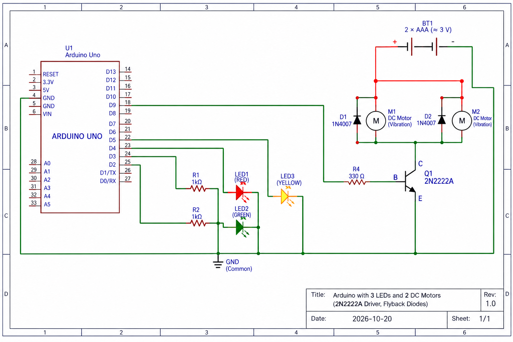

# SAMS hardware

The board side of SAMS: an Arduino Uno that streams the machine's vibration and the worker's close-range distance to the server, and drives the buzzer, the risk LEDs and the vibration motors that simulate a running machine.

- [Schematic](#schematic)
- [Wiring](#wiring)
- [Flashing and checking the board](#flashing-and-checking-the-board)
- [Phone camera](#phone-camera)
- [Recording machine-state training data](#recording-machine-state-training-data)
- [Serial protocol](#serial-protocol)
- [Configuration](#configuration)
- [Troubleshooting](#troubleshooting)

---

## Schematic



The firmware, [`firmware/mpu6050_serial/mpu6050_serial.ino`](firmware/mpu6050_serial/mpu6050_serial.ino), is the reference for pin numbers. The tables below are taken from it. The sketch folder name is historical; the board IMU is an **MPU9250/6500** (WHO_AM_I also recognises MPU6050 / MPU9255).

---


## Wiring


### Sensors


| Device                  | Pins        | Notes                                                                                                     |
| ----------------------- | ----------- | --------------------------------------------------------------------------------------------------------- |
| Accelerometer SDA / SCL | **A2 / A3** | Software I2C. MPU9250 / MPU6500 (also MPU6050 / MPU9255). The boot banner names the chip |
| Accelerometer VCC / GND | 5V / GND    | Mount it on the machine surface                                                                           |
| VL53L0X SDA / SCL       | **A0 / A1** | Software I2C                                                                                              |
| VL53L0X VIN / GND       | 5V / GND    | Leave XSHUT open. Aim it where the worker stands                                                          |


### Actuators


| Device                | Pins                          | Notes                                                                        |
| --------------------- | ----------------------------- | ---------------------------------------------------------------------------- |
| Green LED             | **D2**                        | Anode through a series resistor (220 Ω–1 kΩ), cathode to GND. NORMAL         |
| Yellow LED            | **D3**                        | Same. CAUTION                                                                |
| Red LED               | **D5**                        | Same. DANGER                                                                 |
| Buzzer                | **D8** → +, − → GND           | Active buzzer. If it sounds on 3V but not on D8, switch it with a transistor |
| Motor driver          | **D9** → 330 Ω → 2N2222A base | Emitter to GND. Never drive a motor straight from a pin                      |
| Vibration motors (×2) | Battery + → motor → collector | Each with a 1N4007 flyback diode across it (cathode to +)                    |
| Motor supply          | 2 × AAA (≈ 3 V)               | Battery − to the Arduino GND (common ground)                                 |


The board is powered and read over USB from the server.

---


## Flashing and checking the board

The board on `cu.usbserial-*` is an **Arduino Uno (AVR + CH340)**. Upload as **Uno**.

```bash
export SAMS_HW_SERIAL_PORT=/dev/cu.usbserial-1410

./hardware/tools/hw.sh ports        # list boards
./hardware/tools/hw.sh flash        # full firmware: accelerometer, ToF, buzzer, LEDs, motor
./hardware/tools/hw.sh check        # accelerometer, ToF and actuators answer
./hardware/tools/hw.sh test         # buzzer (expect "RX # ACK B1")
./hardware/tools/hw.sh test-leds    # LED cycle
./hardware/tools/hw.sh monitor      # raw serial; type commands such as M180, V0, ST
./hardware/tools/hw.sh run          # start SAMS with the board
```

Test sketches for isolating one part: `flash-buzzer` (D8), `flash-motor` (D9), `flash-scan` (I2C scan), `flash-mpu-diag` (accelerometer).

On boot the board prints `# SAMS ready chip=…` and plays the **startup sequence**: a beep, green → yellow → red, then a short motor run. On `hw.sh run` the server sends `ST`; the board ignores it for 5 s after a reset, so the sequence doesn't play twice.

Only one program can hold the serial port. Stop Django before `monitor`, `check` or a recording. While Django runs, the board's `#` lines appear in the server log as `MCU RX …`.

---


## Phone camera

Phone browsers block the camera on plain HTTP, so SAMS runs over HTTPS.

```bash
./hardware/tools/hw.sh certs   # after the Mac's Wi-Fi IP changes
./hardware/tools/hw.sh run
```

Open `https://<mac-lan-ip>:8000`, accept the certificate warning, sign in, press **Go Live** and scan the QR code with the phone. On the phone, accept the warning and allow the camera.

If the QR code shows `http://`, restart with `hw.sh run` (it sets `SAMS_HTTPS=1`), or set the address yourself:

```bash
export SAMS_PUBLIC_BASE=https://192.168.1.198:8000
```

---


## Recording machine-state training data

The machine-state model (notebook 02, section 8) learns STOPPED vs RUNNING from this board, mounted as it will stay. Leave-one-recording-out fails when a motor speed only appears once, and STOPPED cannot be held out when there is only one quiet take. Stop Django, then fill the matrix below.

```bash
./hardware/tools/hw.sh coverage --next   # shows gaps and the next commands

# STOPPED — at least one of each disturbance (three sessions minimum)
./hardware/tools/hw.sh record-steady  --seconds 60 --name press01 --disturbance quiet     --note "machine off, quiet"
./hardware/tools/hw.sh record-steady  --seconds 60 --name press01 --disturbance bumps     --note "machine off, bump the mount"
./hardware/tools/hw.sh record-steady  --seconds 60 --name press01 --disturbance footsteps --note "machine off, walk nearby"

# RUNNING — at least two takes per motor level
./hardware/tools/hw.sh record-running --seconds 60 --name press01 --motor low
./hardware/tools/hw.sh record-running --seconds 60 --name press01 --motor medium
./hardware/tools/hw.sh record-running --seconds 60 --name press01 --motor high
./hardware/tools/hw.sh record-running --seconds 60 --name press01 --motor intermittent
```

`record-running` drives the D9 motors itself (`--motor low | medium | high | intermittent | none`), waits for the board's acknowledgement, and switches them off when it ends.

Each run writes `stead_dataset/mpu6050/<time>_<name>[_quiet|_bumps|_footsteps|_running_<motor>].csv` (`sample, seconds_elapsed, x, y, z` in g) and a `.json` with the state, motor setting, disturbance, chip, port, measured rate and note. A run is rejected when the sensor returns identical samples, the reading is not about 1 g, or the rate is not about 50 Hz. After each save, the script reprints the coverage summary.

When `./hardware/tools/hw.sh coverage` reports ready, upload `stead_dataset/` to `MyDrive/SAMS/` and re-run notebook 02 §8. Promote only if leave-one-recording-out stays high for every held-out recording.

---


## Serial protocol

115200 baud, newline-terminated text.

**Board → server**


| Line                                         | Rate         | Meaning                                                                                  |
| -------------------------------------------- | ------------ | ---------------------------------------------------------------------------------------- |
| `ax,ay,az`                                   | 50 Hz        | Acceleration in g                                                                        |
| `TOF:1.23`                                   | ~5 Hz        | ToF distance in metres (0.02–4 m only)                                                   |
| `# TOF raw=… timeout=… status=…`             | ~1 Hz        | ToF alive, nothing in range                                                              |
| `# TOF ready` / `# TOF not found model=0x..` | on (re)init  | ToF presence                                                                             |
| `# SAMS ready chip=<name>`                   | boot         | Firmware up; chip from WHO_AM_I (0x70 MPU6500, 0x71 MPU9250; also 0x68 MPU6050, 0x73 MPU9255) |
| `# IMU not found` / `not responding`         | boot / ~1 Hz | MPU9250/6500 silent on A2/A3; followed by `# I2C A2/A3 …` diagnostics                    |
| `# ACK <cmd>`                                | per command  | Command applied                                                                          |


The ToF runs in continuous mode and is read only when a result is ready, so the accelerometer keeps 50 Hz with or without it.

**Server → board**


| Command                   | Effect                                                   |
| ------------------------- | -------------------------------------------------------- |
| `B0` / `B1` / `B2`        | Buzzer off / caution / danger                            |
| `L0` / `LG` / `LY` / `LR` | LEDs off / green / yellow / red                          |
| `V0` / `V1` / `V2`        | Motors off / intermittent (2 s on, 1 s off) / full speed |
| `M<0-255>`                | Motors at that PWM duty                                  |
| `ST`                      | Startup sequence (ignored for 5 s after boot)            |


---


## Configuration


| Variable                                         | Default                 | Meaning                                               |
| ------------------------------------------------ | ----------------------- | ----------------------------------------------------- |
| `SAMS_HW_SERIAL_PORT`                            | first USB serial device | e.g. `/dev/cu.usbserial-1410`                         |
| `SAMS_HW_SERIAL_BAUD`                            | `115200`                | UART speed                                            |
| `SAMS_HW_BUZZER_ENABLED` / `SAMS_HW_BUZZER_AUTO` | `true`                  | Enable the buzzer / follow the risk level             |
| `SAMS_HW_LEDS_ENABLED` / `SAMS_HW_LEDS_AUTO`     | `true`                  | Enable the LEDs / follow the risk level               |
| `SAMS_HW_TOF_M`                                  | unset                   | Lab only: a fixed ToF distance in place of the sensor |
| `SAMS_HW_TOF_STALE_S`                            | `2.0`                   | Seconds a ToF reading stays usable                    |
| `SAMS_PUBLIC_BASE` / `SAMS_PUBLIC_HOST`          | LAN IP                  | Address encoded in the phone QR code                  |


The accelerometer sample rate and window length come from each model's metadata, not from configuration.

---


## Troubleshooting


| Symptom                      | Cause and fix                                                                                                |
| ---------------------------- | ------------------------------------------------------------------------------------------------------------ |
| `# IMU not found`            | Check SDA/SCL on A2/A3 and 5V for the MPU9250/6500. The `# I2C` lines show which addresses answer, including with SDA/SCL swapped |
| `# TOF not found model=0xFF` | Nothing answered on A0/A1: check wiring and power                                                            |
| Buzzer ACKs but stays silent | D8 can't power it: add a transistor, or use a 3-pin module with VCC on 5V. Passive piezos are not supported  |
| `no ACK for M120`            | Old firmware: run `hw.sh flash`                                                                              |
| Motors don't spin            | Check the battery, the common ground, and the transistor's orientation (E to GND)                            |
| Port busy                    | Django holds it: stop the server first                                                                       |
| QR code shows `http://`      | Start with `hw.sh run`, or set `SAMS_PUBLIC_BASE`                                                            |


## API


| Method     | Endpoint                | Description                                                                |
| ---------- | ----------------------- | -------------------------------------------------------------------------- |
| GET        | `/api/hardware/status/` | Board, buzzer, LEDs, camera, ToF                                           |
| GET · POST | `/api/hardware/camera/` | QR session status, or `{ "action": "start" | "stop" }`                     |
| GET        | `/cam/<token>/`         | Phone join page                                                            |
| POST       | `/cam/<token>/frame/`   | Phone uploads a JPEG                                                       |
| GET        | `/api/control/live/`    | Classify the latest frame, read the board, run fusion, drive the actuators |


